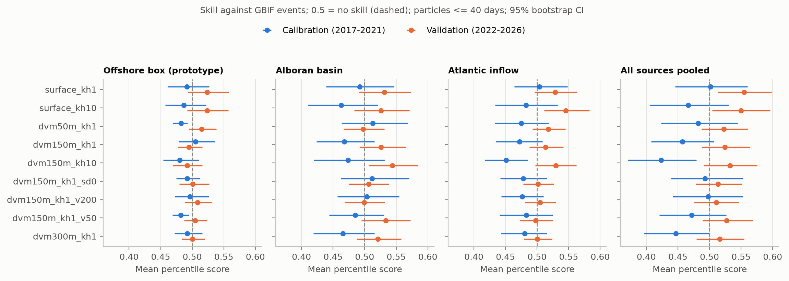

# jellydrift — jellyfish stranding hindcasts for the Alboran Sea

**Can ocean currents alone explain when and where mauve stingers (*Pelagia noctiluca*) wash up on
the beaches of southern Spain?** This repository contains an open, reproducible Lagrangian model
that transports virtual jellyfish with Copernicus Marine currents, records where they strand along
the Alboran Sea coast (Strait of Gibraltar to Cabo de Gata), and tests the predicted stranding
index against ten years of public citizen-science observations.

> Status: research prototype (v0.1). It is a hindcast/skill study, **not** an operational
> forecasting or bathing-safety service.

## Result (v0.1)

Scored against 181 citizen-science events (2017–2026) with a metric that is robust to observer
effort, the modelled stranding index shows **no robust skill**. The configuration selected on
2017–2021 scores **0.501 on 2022–2026** (0.5 = chance). A weak signal appears only for passive
surface drifters (0.555 in 2022–2026, p = 0.006, but 0.501 in 2017–2021), which does not survive a
correction for multiple comparisons, and an evidence-based diel vertical migration does not improve
agreement. The evaluation is validated with positive and null controls. Full results, figures and
discussion: [technical report](report/report.md); tables: [`report/results/`](report/results).



## Why a transport model rather than machine learning

Beach-level jellyfish observations are sparse, presence-only, strongly biased towards summer and
tourist beaches, and vary enormously from year to year. A supervised model trained per beach would
need many years of labelled data per site. A physically based transport model needs no training
data: it encodes the hypothesis that *where the water goes, the jellyfish go*, plus a small number
of biological parameters that can be tested against observations. This follows earlier work in the
Ligurian Sea (Berline et al., 2013) and the Gulf of Naples (D'Ambra et al., 2025).

## Method in one page

| Component | Choice |
|---|---|
| Currents | Copernicus Marine *Mediterranean Sea Physics Reanalysis* (MEDSEA_MULTIYEAR_PHY_006_004), 1/24° (~4 km): hourly surface currents + daily 3-D currents |
| Domain | 5.8°W–1.5°W, 35°N–37°N |
| Particle tracking | 4th-order Runge–Kutta in geographic coordinates, bilinear/linear interpolation, 30-min step |
| Sub-grid dispersion | isotropic random walk, horizontal diffusivity *K*<sub>h</sub> ∈ {1, 10} m² s⁻¹ |
| Vertical behaviour | diel vertical migration synchronised with the sun: 5 m at night, an individual day depth around 50, 150 or 300 m (or a passive surface control), 100 m h⁻¹ swimming, ≥ 100 m above the seabed and no migration over bottoms < 100 m; currents interpolated in depth between 8 levels (0–304 m). Evidence and choices: [`docs/vertical_behaviour.md`](docs/vertical_behaviour.md) |
| Release | continuous, 200 particles/day from each of three alternative source areas (below) |
| Stranding | a particle in the upper 25 m that enters a land cell of the ocean model is stranded at its last wet cell; age at stranding is recorded (max. 40 days) |
| Coast | coastal model cells grouped into 31 segments of 0.125° longitude (~11 km), labelled with the nearest town |
| Observations | 316 GBIF occurrences of *P. noctiluca* (mostly iNaturalist), 181 coastal *events* (segment-days) in 2017–2026 |

**Source hypotheses** (simulated together, tagged per particle):

1. *Offshore box* — the release area of the original prototype (4.4°W–3.0°W, 35.9°N–36.3°N);
2. *Alboran basin* — animals everywhere offshore (a transport-only null hypothesis);
3. *Atlantic inflow* — animals imported through the Strait of Gibraltar by the Atlantic Jet.

**Skill metric.** Citizen-science records only tell us where and when jellyfish *were* seen. Each
observed event (segment *s*, day *d*) is therefore ranked against the modelled stranding index at
the same segment on the surrounding days *d* ± 15 (a stranding up to one day before an observation
counts). The mean percentile score is 0.5 for a model with no skill, independently of the strong
seasonality and spatial bias of observer effort. Significance comes from a permutation test that
moves each event to a random day within its own window. Configurations are **selected on
2017–2021** and **validated out of sample on 2022–2026**.

## Reproduce

Requires Python ≥ 3.12, [uv](https://docs.astral.sh/uv/) and a free
[Copernicus Marine](https://data.marine.copernicus.eu/register) account.

```bash
uv sync
uv run copernicusmarine login              # stores credentials in ~/.copernicusmarine
uv run jellydrift observations             # GBIF occurrences -> data/observations/
uv run jellydrift download surface         # ~3.5 GB of hourly surface currents
uv run jellydrift download deep            # daily currents at 7 levels between 10 and 300 m
uv run jellydrift sweep --experiment all   # 4 behaviour hypotheses + 5 sensitivity runs, x 10 years
uv run jellydrift evaluate                 # -> outputs/evaluation/skill.csv, selection.json
uv run jellydrift figures                  # -> report/figures/
uv run pytest                              # unit tests (analytic flows, scoring)
```

All settings live in [`config/default.yaml`](config/default.yaml). Runs are deterministic for a
given seed.

## Repository layout

```
config/default.yaml        experiment configuration
src/jellydrift/
  field.py                 gridded currents, depth interpolation, land masks, bathymetry
  behaviour.py             diel vertical migration (and passive control)
  model.py                 particle release, RK4 advection, diffusion, stranding
  coast.py                 coastal cells and segments
  observations.py          GBIF download and matching to coastal segments
  evaluate.py              stranding index and presence-only skill scores
  figures.py               report figures
  download.py, cli.py      data download and command-line interface
data/observations/         GBIF records (slim, no observer names) and press-reported events
docs/vertical_behaviour.md evidence review behind the vertical-behaviour model
report/                    technical report, figures and result tables
tests/                     unit tests
```

## Data sources and licences

- **Currents:** E.U. Copernicus Marine Service Information; Escudier, R. et al. (2020).
  *Mediterranean Sea Physical Reanalysis (CMEMS MED-Currents).*
  <https://doi.org/10.25423/CMCC/MEDSEA_MULTIYEAR_PHY_006_004_E3R1>. Not redistributed here;
  download with the commands above.
- **Observations:** GBIF.org occurrence records of *Pelagia noctiluca* (iNaturalist research-grade
  observations and other datasets). Each record keeps its own licence (CC0, CC BY or CC BY-NC),
  listed per row in `data/observations/pelagia_noctiluca_gbif.csv`.
- **Press report used in the case study:** AZ Costa del Sol, 29 March 2022,
  "Plaga de medusas en la Costa del Sol en pleno temporal primaveral".

Code: MIT licence. Report text and figures: CC BY 4.0.

## Limitations

- Presence-only, effort-biased observations; absence of reports is not absence of jellyfish.
- ~4 km ocean model: individual beaches, harbours and small bays are not resolved.
- No population dynamics (reproduction, mortality, blooms offshore); sources are hypotheses.
- No wave-induced Stokes drift or direct wind drag on the animals.
- Vertical behaviour is parameterised from sparse observations (see `docs/vertical_behaviour.md`):
  no life stages, no temperature-dependent swimming, daily-mean currents below the surface.

## References

- Berline, L., Zakardjian, B., Molcard, A., Ourmières, Y., & Guihou, K. (2013). Modeling jellyfish
  *Pelagia noctiluca* transport and stranding in the Ligurian Sea. *Marine Pollution Bulletin*, 70(1–2),
  90–99. https://doi.org/10.1016/j.marpolbul.2013.02.016
- D'Ambra, I., Saviano, S., Ambrosio, M. A., Botte, V., Iudicone, D., Mazzocchi, M. G., Merquiol, L.,
  & Cianelli, D. (2025). Tracking *Pelagia noctiluca* scyphomedusae by combining modeling and stable
  isotope approaches. *Frontiers in Marine Science*, 12, 1608726.
  <https://doi.org/10.3389/fmars.2025.1608726>
- de la Fuente Roselló, A., Sortino Barrionuevo, J. F., Reyes Corredera, S. J., & Perles Roselló,
  M. J. (2022). Susceptibilidad de afección por enjambres de medusas (*Pelagia noctiluca*) en las
  playas del litoral occidental de la provincia de Málaga. *Investigaciones Geográficas*, 77,
  239–258. <https://doi.org/10.14198/INGEO.18723>
- Escudier, R. et al. (2020). Mediterranean Sea Physical Reanalysis (CMEMS MED-Currents).
  <https://doi.org/10.25423/CMCC/MEDSEA_MULTIYEAR_PHY_006_004_E3R1>
- Ferraris, M., Berline, L., Lombard, F., Guidi, L., Elineau, A., Mendoza-Vera, J. M., Lilley, M. K. S.,
  Taillandier, V., & Gorsky, G. (2012). Distribution of *Pelagia noctiluca*
  (Cnidaria, Scyphozoa) in the Ligurian Sea (NW Mediterranean Sea). *Journal of Plankton Research*,
  34(10), 874–885. https://doi.org/10.1093/plankt/fbs049
