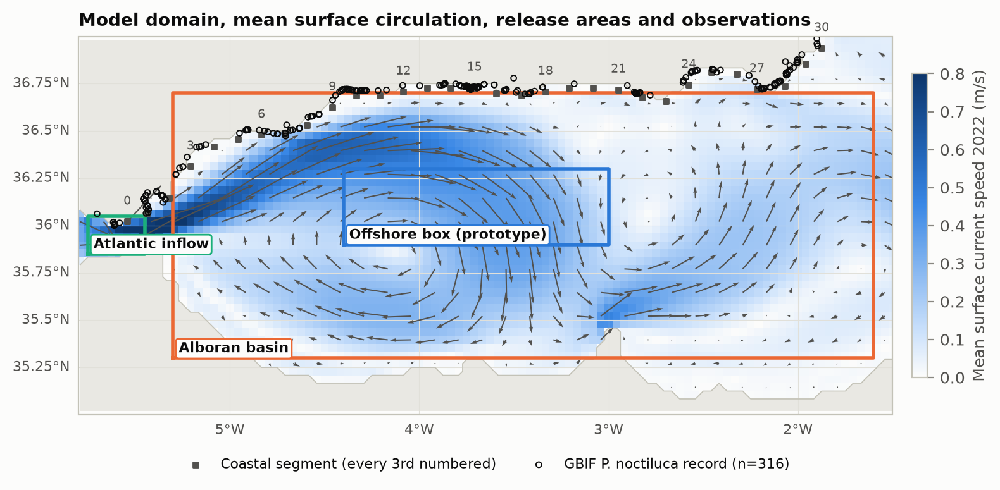
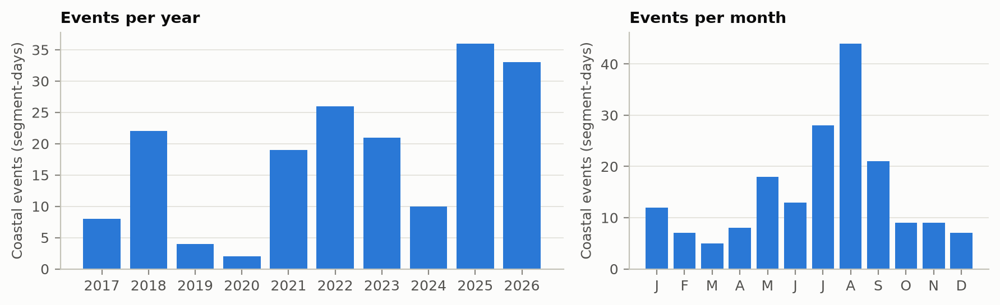
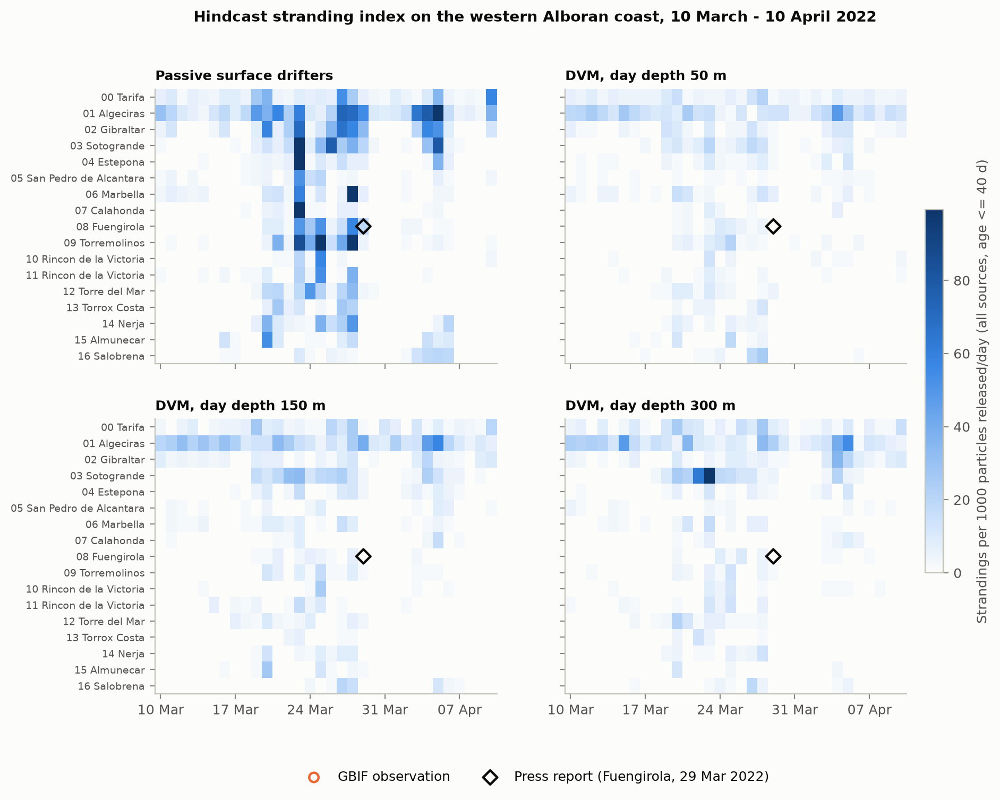
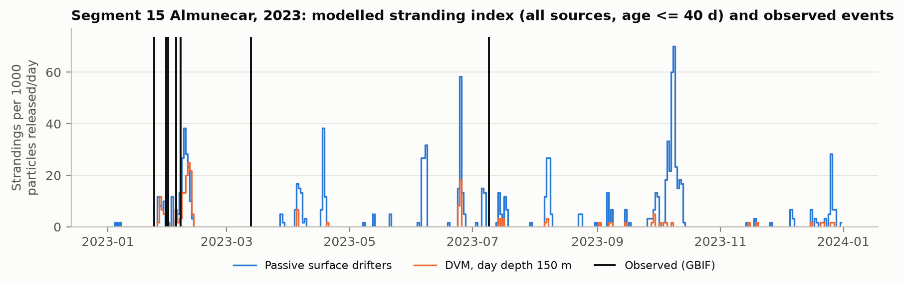
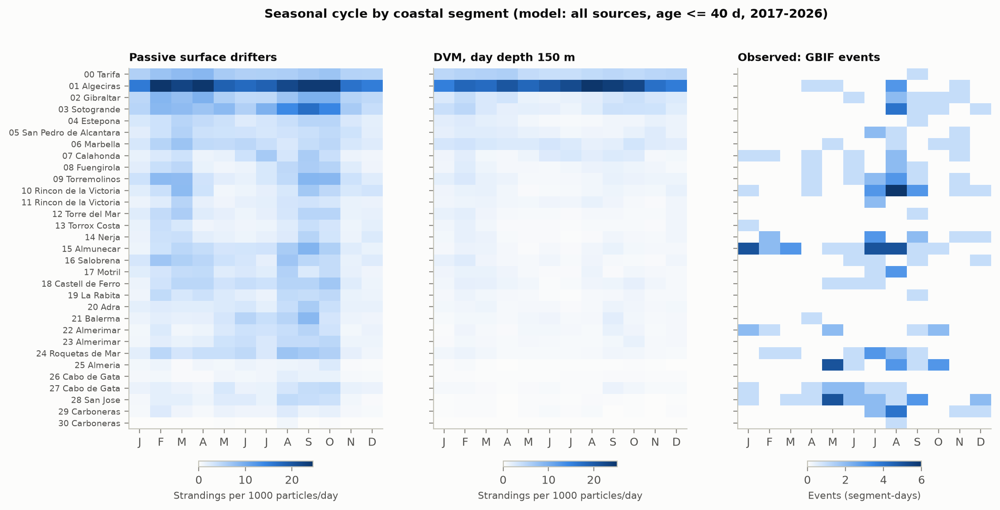
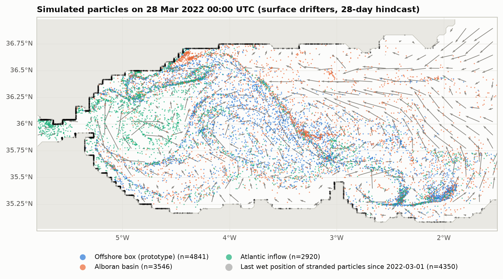
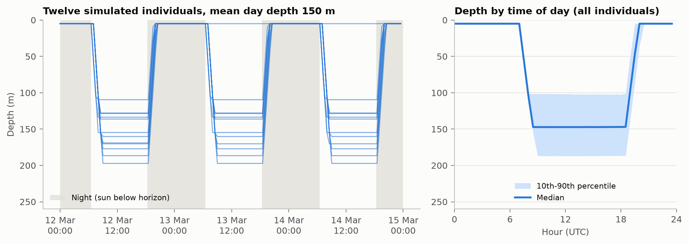

# Do ocean currents explain mauve-stinger strandings on the Alboran Sea coast? An open Lagrangian hindcast evaluated with citizen-science records

**Carlos Herrera Pérez** · Technical report, v0.1 · 2026

**Abstract.** Mauve stingers (*Pelagia noctiluca*) regularly strand on the beaches of the Alboran
Sea, but whether their arrival can be anticipated from ocean currents alone has not been tested
openly over many years. We built a reproducible Lagrangian model that releases virtual jellyfish
from three hypothetical source areas, transports them with the Copernicus Marine Mediterranean
reanalysis (1/24°) with or without an evidence-based diel vertical migration (day depths of 50, 150
or 300 m), and records where they strand along 31 coastal segments from Tarifa to Carboneras. The
stranding index was scored against 181 coastal events (2017–2026) derived from public GBIF
occurrences, with a within-segment, ±15-day percentile score that is insensitive to the seasonal
and spatial bias of observer effort, a permutation test, and a calibration (2017–2021) / validation
(2022–2026) split. The configuration selected on the calibration years has no out-of-sample skill
(mean score 0.501, p = 0.47). A weak signal appears only for passive surface drifters (0.555 in
2022–2026, p = 0.006; 0.501 in 2017–2021), which does not survive correction for multiple
comparisons, and vertical migration does not improve agreement. We discuss the likely causes
(presence-only, effort-biased observations; unmodelled offshore abundance; unresolved coastal and
wind/wave-driven transport) and release code, configuration, results and a review of the species'
vertical behaviour to support better-observed follow-up studies.

**Figures.** 1 domain · 2 observations · 3 skill · 4 March 2022 case · 5 segment time series ·
6 seasonality · 7 particle snapshot · 8 vertical behaviour (all in `report/figures/`).

## 1. Introduction

The mauve stinger *Pelagia noctiluca* is the jellyfish most frequently reported on the beaches of
the Costa del Sol and the Granada and Almería coasts. It is holoplanktonic — it has no benthic
polyp stage — lives mainly offshore and performs diel vertical migrations, reaching the surface at
night. Its arrival on beaches is episodic and has direct consequences for bathers and coastal
tourism.

Two families of approaches exist to anticipate these arrivals. *Data-driven* models learn a
statistical relation between environmental conditions and beach observations; they need long,
consistent, labelled records at each beach, which are rarely available. *Transport* models instead
treat jellyfish as Lagrangian particles carried by modelled ocean currents, possibly with simple
behaviour, and ask where they end up. Berline et al. (2013) showed with a 1.25 km model of the
Ligurian Sea that transport, a 0–300 m diel vertical migration, the position of the Northern
Current and the wind largely control *P. noctiluca* strandings. D'Ambra et al. (2025) combined a
Lagrangian model with stable isotopes to trace outbreaks in the Gulf of Naples. For the western
Málaga coast, de la Fuente Roselló et al. (2022) mapped beach susceptibility from InfoMedusa
sightings (summers 2015–2020) and found that wide, south-west-facing bays are affected most often,
which they related to easterly (levante) transport from the Alboran Sea.

This report asks a narrower, testable question: **does an open, reproducible transport model driven
only by a public ocean reanalysis produce a stranding index that is higher on the days when
jellyfish are actually reported, at the places where they are reported?** We simulate ten years
(2017 – August 2026), compare three hypotheses about where the animals come from and several
vertical-migration depths, and score them against public, presence-only citizen-science records
with a metric designed to be insensitive to observer effort.

## 2. Study area

The Alboran Sea is the westernmost basin of the Mediterranean. Its upper-layer circulation is
dominated by the Atlantic Jet entering through the Strait of Gibraltar, which surrounds one or two
large anticyclonic gyres — the Western (WAG) and Eastern (EAG) Alboran Gyres — with a cyclonic
circulation often found in between; a two-gyre regime is more frequent in summer and a single-gyre
or coastal-jet regime in winter (Renault et al., 2012). The northern (Spanish) coast is therefore
alternately bathed by jet water and by the recirculating flanks of the gyres, and exposed to
easterly (levante) and westerly (poniente) wind events.

## 3. Data

### 3.1 Ocean currents
Currents come from the Copernicus Marine *Mediterranean Sea Physics Reanalysis*
(MEDSEA_MULTIYEAR_PHY_006_004; Escudier et al., 2020), a NEMO-based system with variational data
assimilation at 1/24° (~4 km) resolution and 141 vertical levels. We use hourly-mean surface
currents (`cmems_mod_med_phy-cur_my_4.2km_PT1H-m`) and daily-mean currents at the levels nearest to
50, 150 and 300 m (`cmems_mod_med_phy-cur_my_4.2km_P1D-m`) over 5.8°W–1.5°W, 35°N–37°N, from
October 2016 to August 2026.

### 3.2 Jellyfish observations
We downloaded all GBIF occurrences of *P. noctiluca* in 5.8°W–1.5°W, 35.9°N–37°N with coordinates
and no geospatial issues (316 records, retrieved 29 September 2026), mostly iNaturalist
research-grade observations plus citizen-science datasets. Records with day-precision dates and
coordinate uncertainty ≤ 5 km were matched to the nearest coastal cell of the ocean model when it
was within 5 km (295 of 307 records), and collapsed into *events*: unique (coastal segment, day)
pairs. The study period contains **181 events**: 55 in 2017–2021 and 126 in 2022–August 2026. The
records are strongly seasonal (maximum in August) and spatially uneven (Figure 2), reflecting
observer effort as much as jellyfish abundance.

A press report of jellyfish covering Fuengirola beach on the morning of 29 March 2022, after an
easterly storm that started on 28 March (AZ Costa del Sol, 29 March 2022), is used as a qualitative
case study only.

## 4. Model

### 4.1 Particle transport
Each virtual jellyfish at longitude λ and latitude φ moves with the interpolated current (u, v):

  dλ/dt = u / (R cos φ),  dφ/dt = v / R,

with R the Earth radius, integrated with a fourth-order Runge–Kutta scheme and a 30-minute step.
Currents are interpolated bilinearly in space and linearly in time; land values are set to zero for
interpolation. Sub-grid dispersion is an isotropic random walk with standard deviation
√(2 Kh Δt) per step, with Kh = 1 or 10 m² s⁻¹. The implementation is verified
against analytic flows (uniform flow, solid-body rotation, stranding on a straight coast; see
`tests/`).

### 4.2 Vertical behaviour
Which current carries a jellyfish depends on its depth. The behaviour model is built from the
evidence reviewed in `docs/vertical_behaviour.md` (Berline et al., 2013; El Rahi et al., 2020;
Ferraris et al., 2012; Pastor-Prieto et al., 2021; Toma et al., 2026; Vodopivec & Malej, 2025):

- individuals head for 5 m when the sun is below the horizon and for their preferred day depth
  when it is above (sun-synchronised diel vertical migration);
- the preferred day depth is drawn per individual (normal distribution, relative s.d. 0.2) around
  a mean of 50, 150 or 300 m; a passive surface drifter is kept as a control;
- vertical swimming is limited to 100 m h⁻¹, so dawn descents and dusk ascents take hours;
- individuals stay at least 100 m above the seabed (model bathymetry) and do not migrate where
  the bottom is shallower than 100 m;
- horizontal currents are interpolated linearly in depth between the hourly surface field and
  daily fields at 10.5, 26.2, 51.4, 97.9, 153.4, 203.2 and 303.6 m;
- only individuals in the upper 25 m can strand; deeper ones meeting a steep coast keep their
  position for that time step.

Figure 8 shows the resulting depth cycle. Temperature-dependent swimming, life stages, storm
avoidance and moonlight are not modelled (reasons in `docs/vertical_behaviour.md`). The vertical
speed (50 and 200 m h⁻¹), the individual spread (s.d. 0) and the diffusivity (10 m² s⁻¹) are
tested in a sensitivity experiment around the 150 m migration.

### 4.3 Sources
Three release hypotheses are simulated simultaneously, with 200 particles per day each released
uniformly over sea cells:

| Source | Area | Hypothesis |
|---|---|---|
| Offshore box | 4.4°W–3.0°W, 35.9°N–36.3°N | area used in an earlier prototype of this work |
| Alboran basin | 5.3°W–1.6°W, 35.3°N–36.7°N | jellyfish everywhere offshore; only transport matters |
| Atlantic inflow | 5.75°W–5.45°W, 35.85°N–36.05°N | import through the Strait with the Atlantic Jet |

### 4.4 Stranding and stranding index
A particle stranding is recorded when a step ends in a land cell; it is attributed to the last wet
(coastal) cell. Particles leaving the domain are removed, and particles older than 40 days expire.
Coastal cells north of 36°N between 5.65°W and 1.5°W are grouped into 31 segments of 0.125°
longitude (~11 km), labelled by the nearest town. The **stranding index** of a segment on a day is
the number of strandings per 1000 particles released per day, optionally restricted to particles
younger than 10, 20 or 40 days (a crude proxy for mortality or for the distance of the source).

Each year is simulated separately after a 40-day spin-up. The main experiment has four
behaviours (surface control and 50, 150 and 300 m migrations) with *K*h = 1 m² s⁻¹;
the sensitivity experiment adds five variants (Section 4.2).

## 5. Evaluation

Presence-only records cannot distinguish "no jellyfish" from "nobody reported them", and observer
effort varies strongly by season and beach. We therefore evaluate the model **within each
segment, against nearby days**: for an event at segment *s* on day *d* we compute the mid-rank
percentile of the modelled index at (*s*, *d*) among the indices at *s* on days *d* − 15 … *d* + 15.
A stranding up to one day before the observation counts (the index is smoothed with a trailing
two-day maximum, for every day alike). The mean percentile over events is 0.5 for a model without
skill, whatever the seasonal or spatial distribution of effort, and approaches 1 for a model whose
index peaks exactly on observed days. Significance is assessed with 10 000 permutations in which
each event is moved to a random day of its own window; 95 % confidence intervals come from
bootstrapping events. We also report the *hit rate* (fraction of events with a non-zero index) next
to the *base rate* (fraction of window days with a non-zero index).

All 48 combinations of the main experiment (4 behaviours × 4 source options, including the pooled
index, × 3 age limits) are scored on **2017–2021** to select one configuration, which is then
evaluated **out of sample on 2022–2026**. Sensitivity runs are reported separately and are not
used for selection.

## 6. Results

### 6.1 Circulation and particle fates

The mean surface circulation in the reanalysis shows the Atlantic Jet entering through the Strait
and wrapping around the Western Alboran Gyre (Figure 1); particle clouds are organised by the jet,
the gyre rim and the coastal counter-currents (Figure 7). The simulated migration reproduces the
intended daily cycle: individuals leave the 5 m night layer shortly after sunrise, spend the day
mostly between ~110 and ~190 m (150 m scenario), and return after sunset (Figure 8).

Behaviour changes the fate of the population strongly. Over 2017–2026, 25–44 % of the particles
released strand when they drift passively at the surface, against 7–26 % with a diel migration,
depending on the source (`report/results/stranding_budget.csv`). Particles imported through the
Strait strand most often, and in every scenario the coast of the Strait receives the largest share
of coastal strandings: the Tarifa–Sotogrande segments get 37 % of them for surface drifters and
56–58 % with migration, Algeciras being the top segment in all cases (Figure 6).

### 6.2 Skill against citizen-science events

Table 1 gives the mean percentile score of the four behaviours for the pooled sources and particles
up to 40 days old. Scores of all 48 combinations are in `report/results/skill.csv` and Figure 3.

**Table 1.** Mean percentile score [95 % bootstrap CI], one-sided permutation p-value; 0.5 = no
skill. Hit rate: fraction of events with a non-zero modelled index; base rate: the same fraction on
the surrounding days (2017–2026).

| Configuration | 2017–2021 (n = 55) | 2022–2026 (n = 126) | 2017–2026 (n = 181) | Hit / base rate |
|---|---|---|---|---|
| Passive surface drifters | 0.501 [0.445–0.560], p = 0.480 | 0.555 [0.513–0.598], p = 0.006 | 0.538 [0.503–0.573], p = 0.021 | 0.53 / 0.45 |
| DVM, 50 m | 0.482 [0.423–0.544], p = 0.726 | 0.523 [0.487–0.561], p = 0.117 | 0.510 [0.479–0.542], p = 0.269 | 0.37 / 0.33 |
| DVM, 150 m | 0.457 [0.408–0.507], p = 0.925 | 0.524 [0.488–0.564], p = 0.098 | 0.504 [0.474–0.534], p = 0.406 | 0.35 / 0.33 |
| DVM, 300 m | 0.447 [0.396–0.499], p = 0.965 | 0.516 [0.479–0.555], p = 0.194 | 0.495 [0.466–0.524], p = 0.615 | 0.30 / 0.31 |

**The pre-specified test is negative.** The combination with the highest calibration score
(150 m migration, offshore-box source, particles ≤ 10 days: 0.519 [0.496–0.549], p = 0.034, the
best of 48) has no skill in the validation years (0.501 [0.494–0.508], p = 0.47). With 55
calibration events the confidence intervals are about ±0.05 wide, so the calibration period cannot
discriminate between configurations.

**The only signal comes from passive surface drift.** Pooled surface drifters score 0.555
(p = 0.006) in 2022–2026 and 0.538 (p = 0.021) over the whole period, but 0.501 in 2017–2021.
Given the number of configurations examined, this signal does not survive a correction for
multiple comparisons and should be read as a hypothesis, not a result. None of the migrating
scenarios does better than chance in any period.

**The evaluation itself behaves as intended** (`report/results/controls.csv`): synthetic events
drawn from the model's own index score 0.911 (p < 0.001), whereas 200 sets of random dates give a
mean score of 0.499, with 3.5 % of them at p < 0.05.

### 6.3 Sensitivity

Varying the vertical speed (50 or 200 m h⁻¹), removing the inter-individual spread of day depth or
raising the diffusivity to 10 m² s⁻¹ changes the whole-period score of the 150 m migration by less
than 0.01 (0.499–0.510); a higher diffusivity for surface drifters slightly lowers theirs (0.525).
The conclusions above do not depend on these choices.

**Table 2.** Sensitivity runs (pooled sources, particles ≤ 40 days).

| Configuration | 2017–2021 | 2022–2026 | 2017–2026 |
|---|---|---|---|
| DVM 150 m, K_h = 10 m² s⁻¹ | 0.423, p = 0.993 | 0.533, p = 0.059 | 0.499, p = 0.514 |
| DVM 150 m, 50 m h⁻¹ | 0.472, p = 0.833 | 0.527, p = 0.086 | 0.510, p = 0.267 |
| DVM 150 m, 200 m h⁻¹ | 0.498, p = 0.525 | 0.511, p = 0.287 | 0.507, p = 0.338 |
| DVM 150 m, no individual spread | 0.493, p = 0.597 | 0.513, p = 0.239 | 0.507, p = 0.326 |
| Surface, K_h = 10 m² s⁻¹ | 0.466, p = 0.839 | 0.550, p = 0.017 | 0.525, p = 0.098 |

### 6.4 Year-to-year, spatial and seasonal agreement

Scores vary widely between years (surface drifters: 0.41 in 2017, 0.45 in 2018, 0.51–0.53 in
2019 and 2023, 0.57–0.61 in 2020–2022 and 2024, 0.52–0.55 in 2025–2026;
`report/results/skill_by_year.csv`), and years with few events carry large uncertainty. Spatially, the model and the observations disagree: modelled
strandings concentrate near the Strait of Gibraltar, while reports concentrate on the Granada and
Almería coasts (Figure 6). The rank correlation between segment totals is weak for every scenario
(Spearman ρ ≤ 0.25; `report/results/spatial_agreement.csv`), although this comparison is
confounded by where people report. Seasonally, the model strands particles all year round, whereas
reports peak in July–August (Figures 2 and 6).

### 6.5 Case study: March 2022

Passive surface drifters produce the largest stranding episode of the month on the western Costa
del Sol between 23 and 28 March 2022, with peaks at the Fuengirola and Torremolinos segments on 23,
25 and 28 March (the last one day before jellyfish were reported covering Fuengirola beach after an
easterly storm; Figure 4). The migrating scenarios show only weak, scattered strandings in the same days.
A single event cannot validate a model, but it is consistent with the weak surface signal of
Section 6.2. Figure 5 shows the year with most events at the most-reported segment (Almuñécar,
2023): the January–February reports coincide with a modelled stranding episode, while others fall
on days with no modelled strandings.

## 7. Discussion

**Transport alone, at this resolution and scored with these data, does not anticipate reported
strandings.** Several reasons can contribute, and this study cannot separate them.

1. *Observations.* GBIF records are presence-only, few (181 events in ten years), concentrated in
   summer, on some beaches and in recent years (iNaturalist growth). A day without reports is not a
   day without jellyfish. The window-based score is robust to these biases but has little
   statistical power.
2. *Population.* The model assumes a constant supply of animals offshore, so it predicts strandings
   at a given segment on 31–45 % of days (base rates in Table 1). Real arrivals also depend on whether a bloom
   is present offshore, which varies strongly between years and seasons and is not modelled.
3. *Physics.* The 1/24° reanalysis does not resolve bays, harbours or the 1–2 km coastal band where
   animals actually beach, and its currents do not include wave-induced Stokes drift or the direct
   effect of wind on surface-dwelling animals. The fact that the only (weak) signal comes from
   surface drifters, that the March 2022 event followed an easterly storm, and that strandings on the
   Moroccan Alboran coast correlate with wave height (Aouititen et al., 2019) all point to
   surface wind- and wave-driven transport as the most promising missing process.
4. *Behaviour.* Adding an evidence-based diel vertical migration did not improve agreement. This
   does not show that the animals do not migrate: it suggests that the animals reaching beaches may
   be those caught near the surface (e.g. over the shelf or during storms) rather than a
   representative sample of the offshore population, or that the effect of behaviour is swamped by
   the factors above.

**Comparison with previous work.** Berline et al. (2013) found qualitative agreement between
modelled arrivals and one summer of observations on the Ligurian coast; the quantitative,
out-of-sample test used here is stricter. The beach susceptibility pattern described for the
western Málaga coast by de la Fuente Roselló et al. (2022), with wide, south-west-facing bays
affected most often, involves scales the 4 km model cannot resolve.

**What would make the next version informative.** (i) Daily, effort-controlled beach observations
with absences, such as lifeguard flag records, which would allow proper verification (e.g. Brier
score, ROC). (ii) Stokes drift from the Copernicus Mediterranean wave reanalysis and a small wind
drag for surface individuals, tested as a pre-declared hypothesis. (iii) A proxy for offshore
abundance (e.g. bloom indicators) instead of a constant supply. (iv) Higher-resolution coastal
currents where available.

**Limitations.** Presence-only observations and effort bias; ~4 km ocean model; daily-mean
currents below the surface; no Stokes drift or wind drag; no population dynamics; idealised source
areas; vertical behaviour parameterised from sparse observations with no life stages or
temperature-dependent swimming; the model is a hindcast built on a reanalysis and is not a
forecasting or bathing-safety tool.

## 8. Conclusions

- An open, tested and reproducible Lagrangian framework for jellyfish stranding hindcasts in the
  Alboran Sea is available, together with a review of the vertical behaviour of *P. noctiluca*.
- Scored against ten years of public citizen-science records with an effort-robust metric,
  transport by 1/24° reanalysis currents shows no robust skill; the configuration selected in
  advance has no skill out of sample.
- A weak, non-robust signal appears only for passive surface drift, and evidence-based diel
  vertical migration does not improve agreement.
- Better observations (with absences) and surface wind/wave transport are the priorities for
  a next version.

## Figures

**Figure 1.** Model domain, mean 2022 surface current speed and direction, release areas, coastal
segments and GBIF records of *P. noctiluca*.

**Figure 2.** Coastal events (segment-days with at least one GBIF record) per year and per month.

**Figure 3.** Mean percentile score of every run (95 % bootstrap CI) for each source, calibration
and validation periods, particles up to 40 days old.

**Figure 4.** Modelled stranding index on the western Alboran coast, 10 March – 10 April 2022, for
the four behaviours (pooled sources), with GBIF records and the 29 March 2022 press report.

**Figure 5.** Modelled stranding index at the most-reported segment (Almuñécar) in its year with most
events, for surface drifters and the 150 m migration, and observed events.

**Figure 6.** Mean monthly stranding index per segment (surface drifters and 150 m migration) and
observed events.

**Figure 7.** Positions of simulated surface drifters after a 28-day hindcast (March 2022), coloured
by source, and the last wet positions of stranded particles.

**Figure 8.** Simulated depth of twelve individuals over three days (left) and depth percentiles by
time of day for all individuals (right), 150 m migration, March 2022.

## 9. Data and code availability

Code, configuration, observation tables, result tables (`report/results/`) and figures: this
repository (MIT licence for code, CC BY 4.0 for text and figures). Simulated strandings (~130 MB of
Parquet files) are regenerated with `jellydrift sweep`. Ocean currents: E.U. Copernicus Marine Service Information.
Observations: GBIF.org; each record keeps its original licence.

## References

- Berline, L., Zakardjian, B., Molcard, A., Ourmières, Y., & Guihou, K. (2013). Modeling jellyfish
  *Pelagia noctiluca* transport and stranding in the Ligurian Sea. *Marine Pollution Bulletin*, 70(1–2),
  90–99. https://doi.org/10.1016/j.marpolbul.2013.02.016
- D'Ambra, I., Saviano, S., Ambrosio, M. A., Botte, V., Iudicone, D., Mazzocchi, M. G., Merquiol, L.,
  & Cianelli, D. (2025). Tracking *Pelagia noctiluca* scyphomedusae by combining modeling and stable
  isotope approaches. *Frontiers in Marine Science*, 12, 1608726.
  https://doi.org/10.3389/fmars.2025.1608726
- de la Fuente Roselló, A., Sortino Barrionuevo, J. F., Reyes Corredera, S. J., & Perles Roselló,
  M. J. (2022). Susceptibilidad de afección por enjambres de medusas (*Pelagia noctiluca*) en las
  playas del litoral occidental de la provincia de Málaga. *Investigaciones Geográficas*, 77,
  239–258. https://doi.org/10.14198/INGEO.18723
- El Rahi, J., Weeber, M. P., & El Serafy, G. (2020). Modelling the effect of behavior on the
  distribution of the jellyfish Mauve stinger (*Pelagia noctiluca*) in the Balearic Sea using an
  individual-based model. *Ecological Modelling*, 433, 109230.
  https://doi.org/10.1016/j.ecolmodel.2020.109230
- Escudier, R., Clementi, E., Omar, M., Cipollone, A., Pistoia, J., Aydogdu, A., Drudi, M.,
  Grandi, A., Lyubartsev, V., Lecci, R., Cretí, S., Masina, S., Coppini, G., & Pinardi, N. (2020).
  Mediterranean Sea Physical Reanalysis (CMEMS MED-Currents) (Version 1) [Data set]. Copernicus
  Monitoring Environment Marine Service. https://doi.org/10.25423/CMCC/MEDSEA_MULTIYEAR_PHY_006_004_E3R1
- Ferraris, M., Berline, L., Lombard, F., Guidi, L., Elineau, A., Mendoza-Vera, J. M., Lilley, M. K. S.,
  Taillandier, V., & Gorsky, G. (2012). Distribution of *Pelagia noctiluca*
  (Cnidaria, Scyphozoa) in the Ligurian Sea (NW Mediterranean Sea). *Journal of Plankton Research*,
  34(10), 874–885. https://doi.org/10.1093/plankt/fbs049
- Pastor-Prieto, M., Bahamon, N., Sabatés, A., Canepa, A., Gili, J.-M., Carreton, M., & Company,
  J. B. (2021). Spatial heterogeneity of *Pelagia noctiluca* ephyrae linked to water masses in the
  Western Mediterranean. *PLoS ONE*, 16(4), e0249756. https://doi.org/10.1371/journal.pone.0249756
- Renault, L., Oguz, T., Pascual, A., Vizoso, G., & Tintoré, J. (2012). Surface circulation in the
  Alborán Sea (western Mediterranean) inferred from remotely sensed data. *Journal of Geophysical
  Research: Oceans*, 117(C8). https://doi.org/10.1029/2011JC007659
- Toma, M., Rivela, A., Angiolillo, M., Bavestrello, G., Canese, S., Cau, A., & Bo, M. (2026).
  Insights into the presence and ecology of *Pelagia noctiluca* (Forsskål, 1775) in the deep
  Mediterranean Sea. *Marine Environmental Research*, 221, 108328.
  https://doi.org/10.1016/j.marenvres.2026.108328
- Vodopivec, M., & Malej, A. (2025). Spatially explicit individual-based model reveals the mauve
  stinger jellyfish distribution in the Mediterranean Sea. *Ecological Modelling*, 505, 111109.
  https://doi.org/10.1016/j.ecolmodel.2025.111109
